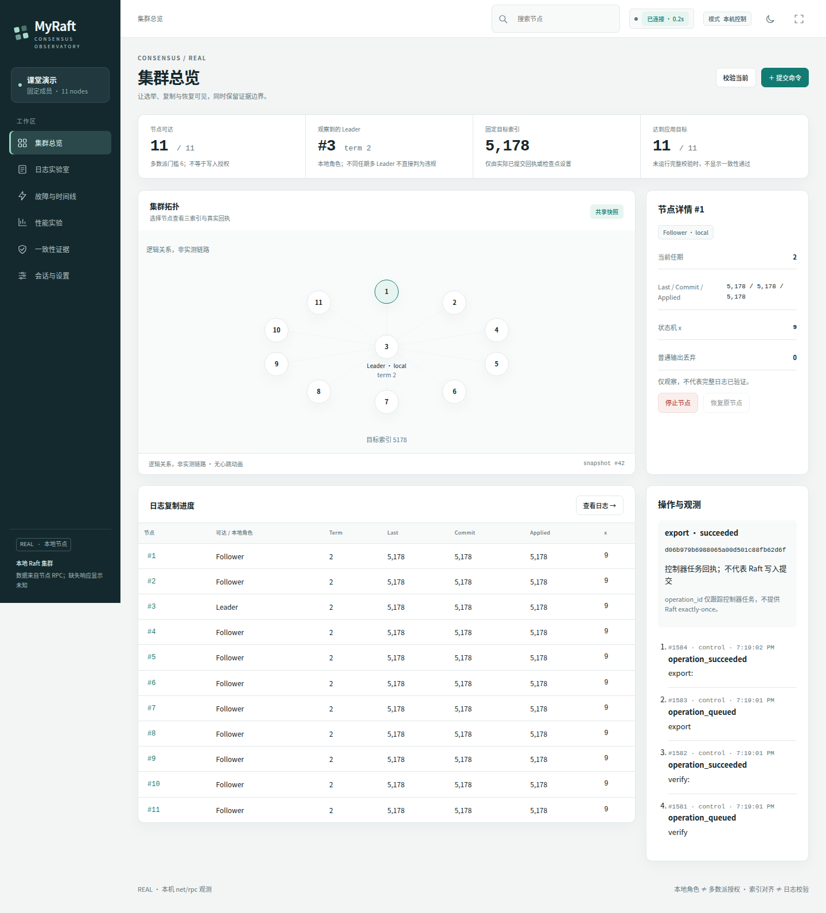
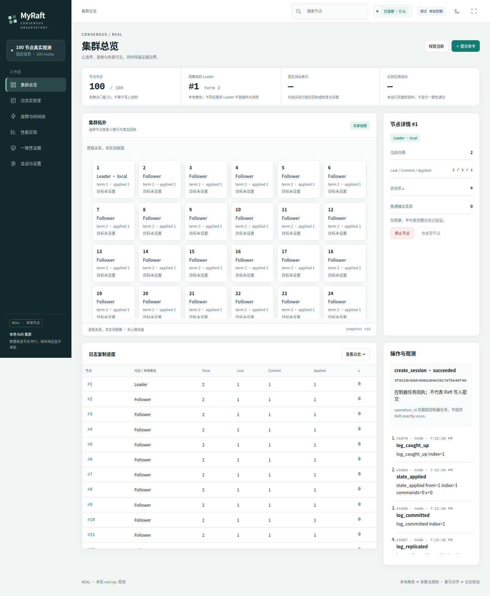
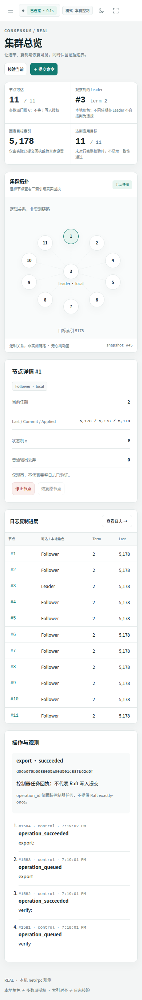

# MyRaft 本机控制台与本轮修复

控制台是原 CLI 之外的可选入口。节点仍使用固定成员 Raft、TCP net/rpc 和 WAL v2；浏览器只读取控制器快照、发起受控任务，不参与选举、计算多数派或直接访问 WAL。原课程 a–g 的启动、选举、复制、追赶、分歧实验、运行日志和课程报告入口全部保留。

## 启动与演示

在项目根目录运行，使用 Go 1.26.3 或满足 go.mod 的更新版本；性能实验另需 Python 3。前端无 Node 构建步骤，HTML/CSS/JS 由 Go embed 打包。

```powershell
go build -o raft-node.exe .
go build -o raft-console.exe ./cmd/dashboard
# 默认只读，登记由 start.bat 等方式启动的集群
.\raft-console.exe -config demo-runs/classroom/nodes.json
# 或创建页面受控的新会话
.\raft-console.exe -node-bin .\raft-node.exe -source-dir . -python python -allow-control
```

这两种方式任选一种，浏览器打开打印的 `http://127.0.0.1:8080`。端口冲突时使用 `-listen 127.0.0.1:8081`。Linux 对应命令去掉 `.exe`、使用 `./raft-console` 和 `-python python3`。

受控演示步骤：

1. “会话与设置”明确启用控制，创建 11 节点。配置、程序副本和数据保存在 `dashboard-runs` 下的独立会话。
2. “集群总览”提交 2101 条命令，种子 42。查看真实回执的 Accepted/Committed、固定目标索引及全部节点应用进度。
3. “一致性证据”运行当前校验并保存历史检查点 index/hash/x。
4. 选择当前 Leader，停止时确认影响范围；多数派重选后继续写入。恢复原节点，待其追赶后分别运行当前校验和历史校验。
5. “日志实验室”选择 1–8 个节点，按索引读取真实条目，点击同一索引比较 term、Command 和 noop。窗口默认 32 个页面格；RPC 默认 128、上限 256。
6. “性能实验”选节点规模、场景、命令数、轮数、种子和批次。每次实验独立构建、独立目录；原始成功/失败/中断数据均保留。
7. “一致性证据”生成并下载 ZIP，检查配置身份、摘要、回执、历史检查点及原始实验 JSON/CSV。

关闭浏览器不会停止节点；正常关闭控制器会停止它自己持有的进程并保留数据。重开同一 `-data-root` 可选择旧会话，明确启用控制后“恢复原会话”。控制器不凭旧 PID 接管仍存活的外部进程。成员变化必须新建会话；原 `start.bat` 继续提供 Windows 独立终端。

## 修复与安全边界

|问题及复现|实际修改|对应回归|
|---|---|---|
|旧数据没有固定成员身份，旧 3 节点 Leader 可误用单节点配置恢复|`config/identity.go`、`raft/raft.go`/`storage.go`：规范化成员 ID 与 cluster_id 绑定持久元数据；路由地址独立；错误身份在可写恢复和协议处理前拒绝|`TestFixedMembershipRestartCannotSplitHistory`，原多数派继续写入、原配置恢复及历史前缀检查|
|旧 WAL 无身份不能证明原成员|`raft/claim.go` 与 CLI `-claim-legacy`：明确声明原配置，先只读审计、同步备份，再绑定身份；不擦盘、不改 WAL v2|认领备份、损坏拒绝、空 WAL、正常恢复测试|
|普通输出持 Node.mu，可拖住 Status/协议|`raft/events.go`：容量 256 队列、单消费者；普通输出满时丢弃计数；事件环和 LogRange 有界|阻塞 sink 下 Status/Stop 测试；Sync 语义保持不变|
|提交发现等待全部节点的完整 Status|`rpc/client.go`：最多 8 路 Summary，发现合法 Leader 后取消剩余读取；仅明确未受理的 not leader 可重发现|慢 Follower、未知写入不重发、复用 CLI 与控制器|
|100 节点选举前创建 9900 个 peer worker|`raft/raft.go`：首次当选才创建，每 peer 一个，后续任期复用|100 节点计数、跨任期复用、Stop 竞争、旧回复与原分区回归|
|控制台过期校验依赖墙钟精度|`cmd/dashboard/operations.go`：以共享快照序号和指纹判断是否过期；保留 generation 检查|Win11 原生复现，等时间戳确定性回归与 10 次 race 重复|
|构建无法及时取消；清理再次失败被误归类|`scripts/benchmark.py`：受控 Popen、取消轮询、工具超时、自有进程树清理；明确 CLEANUP_FAILED|fake-go、进程树/sentinel、超时、双重清理失败|
|实验和 journal 解码大整数失真|实验、发布副本、journal 使用 Decoder.UseNumber，导出保持原整数|9007199254740993 经读取、持久化、重载、导出不变|

附件的 TestProbe PASS 是原问题复现，不代表修复认证。本轮先在 Go 1.27.2 的隔离基线重跑探针，再改为修复后的回归断言；未将附件辅助 GOPATH 覆盖项目。旧成员变更案例是违反固定成员前提的运行保护缺口，不是标准 Raft 反例。

旧数据认领必须使用原配置：为原 nodes.json 增加共同的 cluster_id 后，对每个旧节点运行 `raft-node -config 原配置 -data-dir 原数据 -id N -claim-legacy`。节点保存备份和摘要清单；无法从缺失的历史身份自动推断原成员。不要用“当前想要的配置”冒充原配置。

## 采集、接口与状态语义

`cmd/dashboard/collector.go` 每轮先以 Summary 采集，默认间隔 1 秒、最多 8 路并发、两轮不重叠；新增事件通过有界 EventRange 读取。所有浏览器订阅同一快照，完整校验仅按需执行。事件按接收顺序显示，不能据此推断跨机器精确墙钟先后。

|接口|用途|
|---|---|
|GET `/api/session`|当前会话、只读配置、CSRF 启动信息|
|GET `/api/snapshot`|已采集快照，不触发节点全量读取|
|GET `/api/events`|SSE 快照、事件、任务；每订阅单槽通知、有限事件环、gap/drop 可见|
|GET `/api/nodes/{id}/logs?from=1&limit=128&session_id=…&generation=…`|有界真实条目；仅登记 ID；拒绝旧会话响应|
|POST `/api/operations`|关闭类型集合的操作，带 Origin、CSRF、controller_id、session_id、generation|
|GET `/api/operations/{id}`|任务回执；operation_id 不代表 exactly-once|
|GET `/api/exports/{id}`|只下载已成功登记并核对摘要的证据包|

可达、本地角色、任期、样本年龄、受理、提交、全体应用、全体校验分别记录。缺失响应显示未知，过期样本不能冒充在线。不同任期的多个本地 Leader 不直接判作协议违规。默认只读；即使启用控制，停机仍单独确认，未实现真实网络注入时禁用分区按钮。提交结果未知时绝不自动重发。

本机 HTTP 只绑定显式 loopback，检查精确 Host/Origin，不开放 CORS；变更仅 POST + CSRF。进程操作只使用本控制器持有的句柄和保存的程序/参数/启动记录，不接受任意 PID、路径或 shell。配置损坏不会阻止停止自己已拥有的进程。RPC 的集群身份是误配置保护，不是认证，不防恶意伪造。

## 实测与复现

本轮独立证据见 [validation/console-20261019](../validation/console-20261019/README.md)。原 81723b8 的 80 轮及后续 closure/ux/safety 记录保持原样。本轮 Linux 规模实验四场景×四规模各一轮，共 16/16 PASS；只作为功能和规模回归，不能推出稳定尾延迟。

真实 11 节点浏览器流程包含：双击抑制、停机确认取消、2101 条命令、历史检查点、故障重选、旧节点恢复、当前/历史校验、独立实验、中断、ZIP 摘要验证。真实 100 节点截图使用实际 Summary，另有明确标注为 synthetic 的 UI 状态回归；后者不作为 Raft 证据。

同一 11 节点集群，1/5/10 个实际浏览器各观测 5 轮，监测 RPC 均为 55；节点全部 RPC（包含心跳等）分别 395/385/395。0 与 10 个浏览器下各做 6 次 256 命令提交，外部完成观测中位数约 0.228/0.239 秒。此计时含 HTTP、任务轮询（100ms）、调度与浏览器负载；两组均开启共享采集器，只比较浏览器数量，不是“采集器关闭/开启”的协议延迟对比。样本少，不报告可靠 p99 或稳定百分比收益。

```powershell
go fmt ./...
go vet ./...
go test -count=1 ./...
go build ./...
go test -race -count=1 ./... # 需要支持的 C 工具链
python -m unittest discover -s scripts -p 'test_*.py'
python scripts/smoke_test.py --nodes 3 11
python scripts/benchmark.py --nodes 10 20 50 100 --entries 2101 --rounds 1 --output .test-output/console-check-new
```

可选开发验收需要 Playwright Python 包和 Chromium，不是项目运行依赖：

```shell
python scripts/dashboard_ui_test.py --url http://127.0.0.1:8080 --output .test-output/ui-new
python scripts/dashboard_e2e.py --dashboard ./raft-console --node ./raft-node --output .test-output/console-e2e-new
```

`dashboard_ui_test.py` 对目标服务只发 GET，包含显式 synthetic UI 夹具。`dashboard_e2e.py` 会创建自己的控制器和真实节点，用于 Linux/类 POSIX 的开发验收；Windows 用原生控制台步骤或本轮原生 HTTP 验证记录。Windows 的 `Popen.terminate()` 不会发送 Go 的优雅退出信号，不应据此宣称浏览器脚本具备 Windows 树清理保证。

## 实际页面

下图来自实际运行；没有使用原型样例状态填充。完整日志页、故障页、实验页、证据页、设置、暗色和投影模式图均在 [console-screenshots](console-screenshots/)。







## 剩余限制

固定成员；无动态成员、快照压缩、请求去重、线性一致读、认证/TLS。长期 WAL 会增长，持久化 Sync 仍在节点锁内。日志视图和校验不是原子跨节点读取。普通展示事件允许丢弃，磁盘持久化不允许。永久卡住且不可关闭的外部 Writer 最多留下一个日志消费者，直至 Writer 返回或进程退出。

复制 worker 在当过 Leader 后保留，轮换足够多次后仍可能达到 N×(N−1)。未知写入无法靠 operation_id 去重。控制器崩溃不自动接管或杀掉遗留进程；原配置和存储锁保护后续恢复。实验取消优先协作清理；超时终止 runner 只能报告 cleanup_unconfirmed，Windows taskkill 也不等同于 Job Object 的崩溃级树回收保证。导出的事件/回执是有界窗口，不能替代完整节点审计日志。

原生 Windows 未运行 race（没有对应 C 工具链），未在另一台“统一 Win11 测试机”执行验收；没有多机/WAN、浏览器兼容矩阵或生产安全认证结论。
