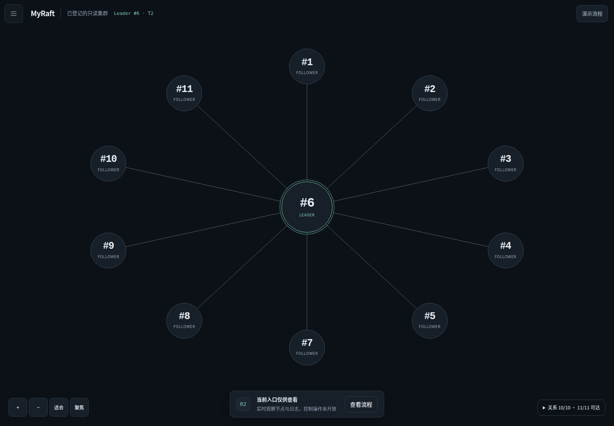
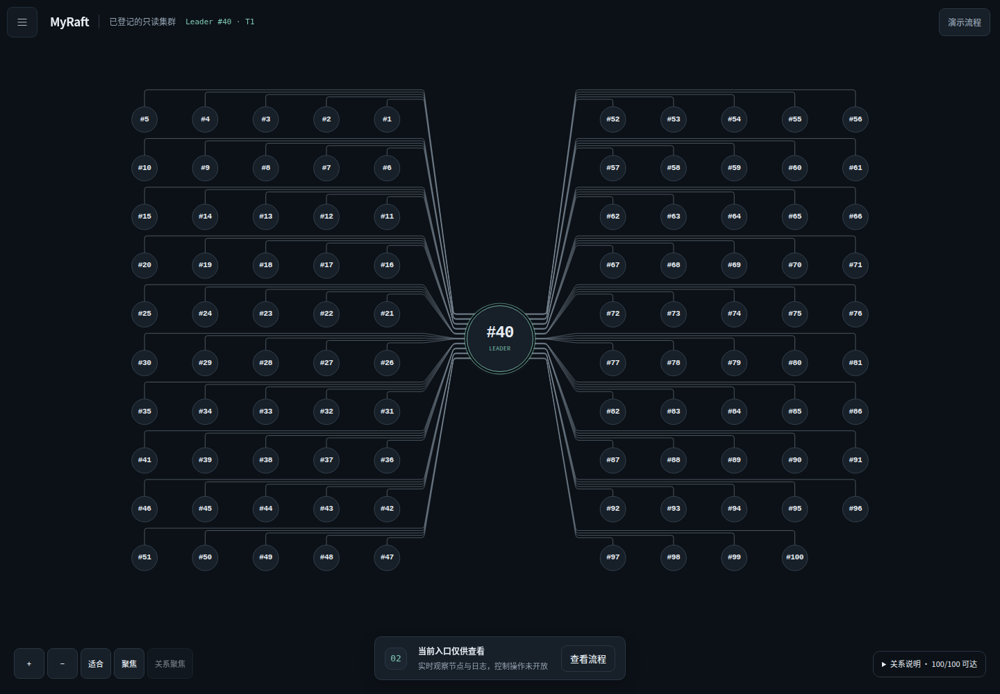

# 中心拓扑与课堂操作修订

基线为 `3ed2d82775bdd2cd6fbbc77cc274433b5ec21603`。本轮只修改浏览器代码、测试与说明；Go Raft、WAL、net/rpc、HTTP 接口和 Windows 独立终端入口未改。历史实验、ZIP 和验收状态保留。本轮使用 Linux Chromium；不能将它等同于新版本的 Windows 桌面验收。

## 界面与连线

首页采用深石墨背景、灰蓝节点、银灰关系线和青绿强调。会话观测在上方，课堂下一步在底部；六页导航、完整流程、任务原始回执与节点详情按需展开。

3～15 节点采用中心放射布局；16～100 节点采用中心节点和左右矩阵。矩阵的行间通道只是绘图空间，不表示中继、子集群或网络设备。普通关系从节点边界连到中心边界；异常目标先直连，必要时使用确定性正交避障。没有后台力学布局或空闲数据包动画。

连续两个不同快照序号报告同一节点、同一实例、同一任期的唯一有效 Leader，才将其移动到中心。换届只交换原中心与新 Leader 的槽位。角色与关系立即更新，不等待动画；该两次观测仅用于布局防抖，不是协议确认。缺失实例、无 Leader、多 Leader或过期观测不能累计确认。多 Leader 观测不直接标为协议违规。

连线严格表示：有效 Follower 样本报告的 Leader ID，对应本轮同任期且有效的本地 Leader 角色。它不证明实测链路、AppendEntries ACK 或吞吐。默认显示全部有效关系，选中节点提亮其路径，关闭详情仍保留选择；“关系聚焦”可筛选，图例显示已显示/有效关系数。悬停线条或查看节点详情可以读到关系来源。

“适合”提供全景，“聚焦”恢复可读大小。100 节点在手机全景中只能看整体关系，需要聚焦/放大才能读节点。不能以缩小字体宣称手机全图同时可读。减少动态效果设置关闭换位和事件动画。





## 已修复的问题

|问题及证据|修复|
|---|---|
|旧20节点网格中，直线连接中心会穿过其他节点；隔离浏览器复现15次穿越|边界端口、独立通道、必要时避障；针对实际SVG曲线检查|
|日志页改选节点后，旧请求仍保持loading并可能发布旧结果；新增用例先失败|查询绑定控制器/会话/代次/节点集合/窗口，选择变化即失效并中止旧读；迟到结果与finally均核对查询身份|
|旧检查点会使新提交尚未应用/校验时直接提示故障实验|课堂下一步先检查当前提交、应用和校验；故障恢复后同时要求当前与历史验证|
|只读页面引导用户启用服务端并未开放的控制|明确显示入口限制；受限代理可用响应头 `X-MyRaft-Read-Only: 1` 告知页面禁止所有POST，GET日志读取仍可用|
|“历史缺口”和“快照丢弃0”混成同一警告|历史缺口与快照丢弃分开显示，正常首页收进可展开的关系说明；连接错误仍即时显示|

本轮集成复核还发现并修正了桌面工具条被上下定位撑高、缺失实例没有清除布局待确认、缩放聚焦的坐标换算问题。原始失败输出保留在工作区本轮原始证据目录，没有通过放宽协议断言消除失败。

课堂流程为准备、提交、应用与完整校验、保存检查点、故障与恢复、核查恢复。每一步仍需明确点击；受理、提交、应用、校验分别显示，不确定写入不自动重发。只读代理响应头只影响显示，不是权限保护；服务端与代理仍必须独立限制操作。

## 实际验证

发布前已使用最终部署二进制重新通过真实11/100节点测试，见 [最终构建复验](../validation/publication-20261023/README.md)。初次100节点记录对应较早候选，不能单独作为最终构建的证明。

本轮证据位于 [frontend-enterprise-20261022](../validation/frontend-enterprise-20261022/README.md)，生产静态文件摘要见 `build.json`。源码为基线上的工作区修订，不冒称旧提交已包含本轮代码。

|检查|结果|
|---|---|
|Go格式、vet、build|PASS；没有Go源码修改|
|Linux Go / race|各90顶层＋52子用例通过，1个可选长测跳过|
|Python标准库回归|44通过|
|浏览器合成回归|25项：24通过，1个需要live URL的用例跳过|
|拓扑几何与状态契约|13,330条路径检查通过；包含各规模/Leader槽位和外围目标，未发现穿无关节点；同seq、实例缺失、跨任期、scope重置、缓存与聚焦回归通过|
|画布交互|全景、关系筛选、拖动/点击、双指缩放、键盘、销毁通过|
|真实3/11节点smoke|故障、重启和少数派检查通过|
|真实11节点六页|2101条命令、停止取消、重选、新写入、原盘恢复、固定历史检查点、实验/取消/导出通过；页面错误0|
|课堂下一步真实操作|3节点通过新操作条提交2101条，故障后再提交3条，恢复及原历史检查点通过|
|真实100节点|2101条提交与一致性检查通过，100份WAL独立算术参考均通过；桌面/手机全景与手机可读聚焦通过|
|共享采集|1/5/10浏览器各观察5轮，采集RPC均为55；不随浏览器数量倍增|
|Tailscale预览|新资源逐文件摘要匹配，11节点/10条关系/实时显示通过，POST/PUT/DELETE仍拒绝|

稳定的状态刷新和选择只更新样式，不重新计算路径。复杂的外围 Leader 关系变化仍可能产生一次数十毫秒级路由计算，不声称所有帧都低于16ms；本轮没有将少量延迟样本包装为稳定性能提升。默认单 Leader 布局以无交叉为目标；复杂多 Leader 关系优先保证避开节点和语义真实，不保证任意图零交叉。

新版本的 Windows 原生/可见桌面、Windows race、老师统一电脑、完整课程规模矩阵和新一轮长时压力均未执行，继续记 NOT RUN。旧版本的通过记录不能替代这些项目。

## 复现

先按 README 构建并启动本机控制台。浏览器测试额外需要 Python Playwright 与 Chromium；普通课堂运行不需要 Node 构建链。

```sh
python scripts/dashboard_ui_test.py --url http://127.0.0.1:8080 --output 新浏览器证据目录
python scripts/stage_ui_test.py --output 新画布证据目录
python scripts/topology_ui_test.py --output 新拓扑证据目录
python scripts/dashboard_e2e.py --dashboard ./raft-console --node ./raft-node --output 新真实实验目录
```

前两类合成测试只验证界面和几何，不作为Raft证据。最后一条创建并清理独立真实集群。该脚本目前适用于POSIX；Windows采用现有原生验收入口。
