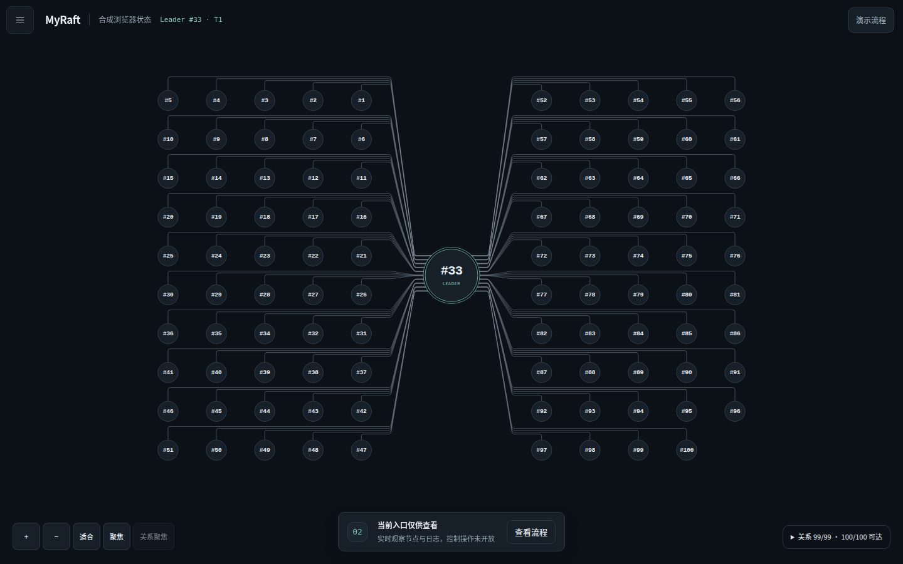
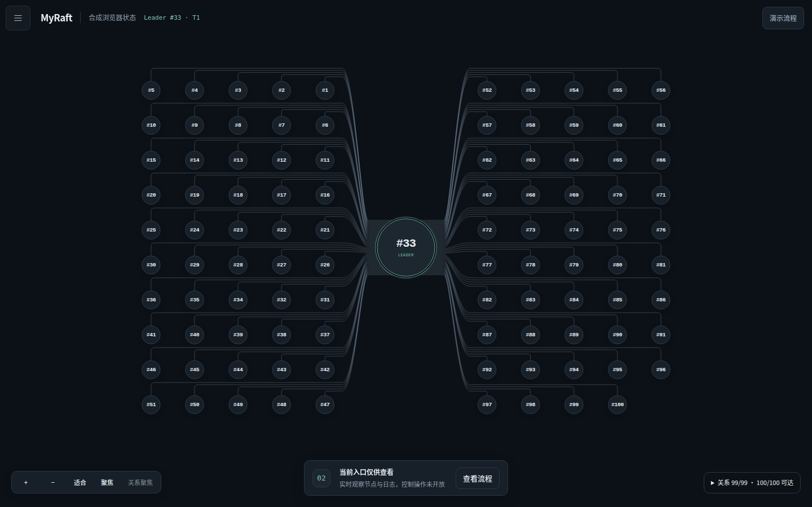
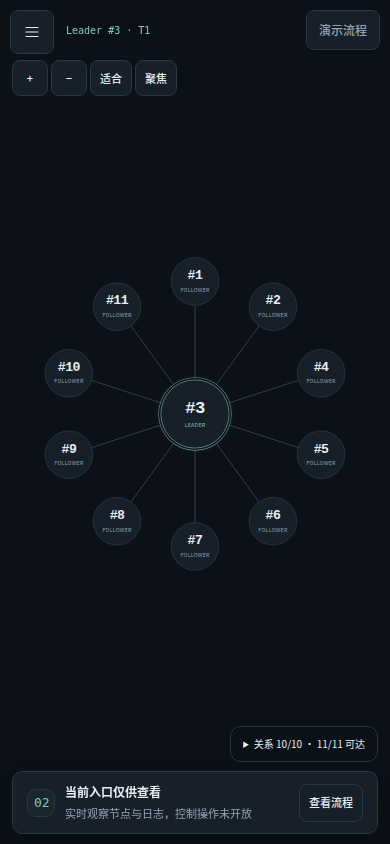
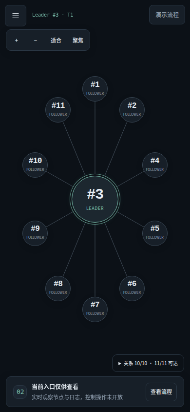

# 拓扑与操作深度修订 · 2026-10-23

基线是 `62d78ea0d62f686622ed1af43da44fe9cc324a66`。本轮在独立分支实现并验收；没有修改 Go 共识、WAL、RPC 或进程控制协议，没有推送远端。原课程、Windows 包和历史证据保留。本报告的 PASS 仅指下面列出的本轮操作。

## 这次改变了什么

- **首次布局**：第一份唯一、身份有效的 Leader 观测用于预置展示中心，避免首次显示先把 Leader 放在边缘、随后全体重排。`centerId` 的确认仍需同实例、同任期的两个递增采样序号。换届只交换原中心与新 Leader 的位置，多 Leader、过期或身份错误不会选出一个“权威 Leader”。
- **密集布线**：保留双侧节点矩阵，独立走线沿有序通道汇入共同截面，再接到 Leader 圆周上按 y 均分的端点。每条线仍对应一个 Follower 报告的 Leader ID 与同任期观测；没有共享总线、中继节点或复制 ACK 的暗示。16～100 节点不再把所有端点压到同一窄缝。
- **单关系追踪**：选中 Leader 不再把全部入边突出；悬停连线、悬停或键盘聚焦 Follower 能突出一条关系及两个端点。提示说明来源与任期。可见线下方有扩大命中区域，并按缓存的近似折线距离选择最近路径，避免稠密线束中选到邻线。关系失效会退出筛选；切换会话清除旧悬停。
- **移动端与视觉**：小集群采用更适合竖屏的椭圆布局，大集群保留全景与可读大小聚焦。平移/缩放后显示倍率及“返回全景”。统一克制的连线、边框、控件、事件时间线和日志差异标记；保持暗色、浅色与投影模式。没有添加虚构流量动画。
- **稳定操作**：实时刷新保留同一流程步骤的焦点、详情展开状态及原始回执内的滚动位置；恢复后再次提交并通过验证，不会错误退回“尚未故障恢复”。未知写入仍只引导检查回执。
- **实验图表**：单个有效样本显示紧凑耗时；多个样本显示逐轮图、均值、中位数、范围与 n。失败、中断、缺少有效耗时分别计数，不跨缺失轮次连线；沿用平台、源码、规模、场景、批次、工作量分组。

新增 `charts.css` 由已有 Go embed 一起打包，无 Node 构建链、新运行依赖或前端框架。

## 已复现问题与修复证据

| 问题 | 修复位置 | 证据 |
|---|---|---|
| 100 节点端点仅约 0.4 世界像素间距；桌面存在大量路径交叉 | `topology.js` | `baseline/geometry/geometry.json` 与 `release/geometry/geometry.json` |
| 首次 Leader 不在中心；成员场景变化未重新适配视图 | `stage.js` | `accepted-topology.txt`、真实五规模三视口 |
| 选 Leader 时全亮；节点容器拦截线悬停；宽命中区误选邻线 | `stage.js`、`topology.js` | 实际鼠标 297 个路径点，`accepted/polish/picking.json` 中误选为 0 |
| 实时刷新丢失 summary 焦点、跳到另一个同名按钮、重置回执滚动 | `app.js`、`views.js` | `baseline/polish-red.txt`、`accepted-polish.txt` |
| 恢复后再次提交使课堂完成状态倒退 | `views.js` | `workflow-red.txt`、`accepted-polish.txt` |
| 单样本绘制两张图、无效耗时参与展示 | `charts.js`、`charts.css` | `chart_ui_baseline.txt`、`final/charts.txt` |
| 一个旧浏览器测试把字符串表达式交给 CSP 禁止的 eval | `dashboard_ui_test.py` | `baseline/browser.txt`；改为函数谓词，保留断言和 CSP，最终通过 |

断线后节点详情是否冒用旧状态的担忧经检查未成立：已有 `samples()` 在不新鲜时清空状态。本轮保留原实现并补充回归，不把它写成已修复的缺陷。开发中的失败输出保留；其中早期人为修改空表 DOM 的滚动探针不能代表真实日志行为，最终用展开的真实格式任务回执替代该探针。

## 前后截图

以下对比使用相同的明确合成输入、Leader ID 和视口，用于视觉比较，不是共识证据。真实运行截图在下一节。

| 场景 | 62d78ea | 本轮 |
|---|---|---|
| 100 节点，1440×900 |  |  |
| 11 节点，390×844 |  |  |

## 本轮真实集群验收

Linux、Go 1.27.2、Python 3.12.7、Playwright Chromium。每一规模使用新配置、独立 cluster ID、数据目录与本轮构建的二进制；没有改变已有会话成员。二进制及生产源码摘要见 [build.json](../validation/frontend-polish-20261023/build.json)。

| 节点数 | 首任→新 Leader | 原检查点 | 最终算术命令数 | 三视口、重选恢复、完整日志及历史校验 |
|---|---|---|---|---|
| 3 | #1 → #2 | 2102 | 2104 | PASS |
| 11 | #3 → #6 | 2102 | 2104 | PASS |
| 20 | #3 → #9 | 2102 | 2104 | PASS |
| 50 | #3 → #2 | 2102 | 2104 | PASS |
| 100 | #95 → #83 | 2102 | 2104 | PASS |

每组先提交 2101 条命令、保存固定前缀，然后关闭 Leader、等待真实重选、新提交 3 条、恢复原节点，比较同一个检查点 index/hash/x。WAL 另用独立 Python 算术参考核对，合计 184 个节点结果通过。三个视口是 1440×900、1920×1080、390×844；节点全部可见且中心未被悬浮控件挡住，缩放、聚焦和返回全景通过。换届后其他节点的位置保持不变。

[逐组结果](../validation/frontend-polish-20261023/real-matrix/results.json)；各组目录含全景、聚焦、重选、恢复截图及算术结果。例如 [真实100节点](../validation/frontend-polish-20261023/real-matrix/n100/overview-1440.png)、[真实11节点手机](../validation/frontend-polish-20261023/real-matrix/n11/overview-390.png)。

独立的 11 节点浏览器完整流程也通过：启用本机控制 → 创建会话 → 双击确认只发送一次 2101 条命令 → 完整校验 → 保存检查点 → 取消停止不产生操作 → 确认停止 Leader → 重选后新提交 → 恢复原节点 → 历史与当前校验。检查点 2102/hash/x 保持不变。随后实际运行并取消独立性能实验、读取有界日志、导出 ZIP 并核对摘要，访问六页及明暗/投影/手机视图。页面错误为 0。

[完整流程结果](../validation/frontend-polish-20261023/real-classroom/results.json) · [性能页](../validation/frontend-polish-20261023/real-classroom/experiments.png) · [日志页](../validation/frontend-polish-20261023/real-classroom/logs.png) · [故障页](../validation/frontend-polish-20261023/real-classroom/faults.png) · [一致性证据](../validation/frontend-polish-20261023/real-classroom/evidence.png)。

## 几何、性能和回归结果

- 几何：15 个规模/视口组合，SVG 每 4 世界像素采样，穿节点、线交叉、水平重叠均为 0；另有 13,330 条路径的端点与节点避障检查通过。100 节点端点最小间距从约 0.37～0.40 提高到 **2.609 世界像素**。采样检查不是所有连续几何与任意视口的数学认证。
- 实际鼠标拾取：100 节点，99 条线各取 25%、50%、75% 位置，共 297 点，错误命中为 0。本机拾取处理 P95 约 3.9ms；包含一次坐标变换读取和高亮更新，没有逐路径 DOM 几何查询。
- 同机合成 Stage 渲染，100 节点每轮 120 次更新、3 轮：首次更新基线 49.1～52.2ms，本轮 9.5～10.5ms；稳定更新 P95 基线 2.3～2.6ms，本轮 2.3～3.0ms。换届第一份未稳定观测仍有非中心避障开销，本轮约 78～82ms。没有把一次测量包装成稳定加速或 Raft 提交性能提升。
- 真实11节点共享采集：1、5、10 浏览器各 5 轮均为 **55 次监控 RPC**。0/10 浏览器各 6 次提交观测的中位数约 224/235ms，数据少且同机执行其他检查，仅作为本轮回归观察，不是可靠 P95/P99 或监控开销上界。
- Go fmt/vet/build 通过；`go test -count=1` 与 Linux race 各 **90 个顶层测试、52 个子测试通过，1 个可选长时 soak 跳过**。
- Python 标准库回归 **44 通过**；原浏览器套件 **24 通过、1 个 GET-only live 用例跳过**（另有完整真实测试）；新增 UI **7 通过**；图表 **14 条断言通过**；Stage 与几何回归通过。

上述时间与计数均可从 [本轮证据目录](../validation/frontend-polish-20261023/README.md) 的原始结果重新核对。正常结束后本轮启动的节点、控制器与监听已清理；没有停止原来运行的预览服务或其他实验。

## 本地使用及复现

在源码根目录：

```bash
go build -o raft-node .
go build -o raft-console ./cmd/dashboard
./raft-console -listen 127.0.0.1:8080 -node-bin ./raft-node -source-dir . -allow-control
```

打开 `http://127.0.0.1:8080`，在会话设置明确启用控制、创建11节点。只查看已启动集群时，使用 `./raft-console -config <原nodes.json>`，不传 `-allow-control`。Windows 使用原入口或相应 `.exe` 名称；本轮未进行 Windows 运行认证。

导航支持左边缘、菜单、Tab、Ctrl+K；选择 Follower 或悬停线条追踪关系。放大后使用“返回全景”定位，100节点手机全景主要用于结构观察，读编号与操作时使用聚焦或节点搜索。

以下浏览器脚本需要测试用 Playwright/Chromium，不是产品运行依赖。`--output` 使用新目录；真实 harness 只清理自己创建的进程。

```bash
python scripts/topology_ui_test.py --output new-evidence/topology
python scripts/layout_audit.py --output new-evidence/geometry
python scripts/render_benchmark.py --output new-evidence/render
python scripts/chart_ui_test.py
# 下两项需要本机先启动控制台，API fixture 明确为合成数据
python scripts/dashboard_ui_test.py --url http://127.0.0.1:8080 --output new-evidence/browser --synthetic-only
python scripts/polish_ui_test.py --url http://127.0.0.1:8080 --output new-evidence/polish --synthetic-only
# 自动启动独立真实集群与控制器，执行后清理
python scripts/frontend_acceptance.py --dashboard ./raft-console --node ./raft-node --output new-evidence/real-matrix
python scripts/dashboard_e2e.py --dashboard ./raft-console --node ./raft-node --output new-evidence/classroom
```

## 剩余限制

- Windows 原生浏览器、人工关窗、Windows race、老师电脑：**NOT RUN**，不沿用旧版本 PASS；本轮没有生成或发布 Windows 新包。
- 100 节点缩小全景仍可能出现亚像素线束，不能保证每条线凭肉眼独立辨认。最近路径拾取、Follower 追踪与可读大小聚焦用于局部观察。
- 换届的第一份快照在保持槽位防抖时会进行非中心避障，个别更新可超过一帧；没有以提前重排或隐藏真实关系规避该开销。
- Chrome/Chromium 已测；没有执行 Safari/Firefox、长时资源测试或本轮完整课程性能统计矩阵。几何检查不穷尽任意缩放、视口或多 Leader 分布。
- 事件队列仍有界；高活动期间会如实提示历史事件缺口，页面不补造事件。关闭浏览器不停止集群。
