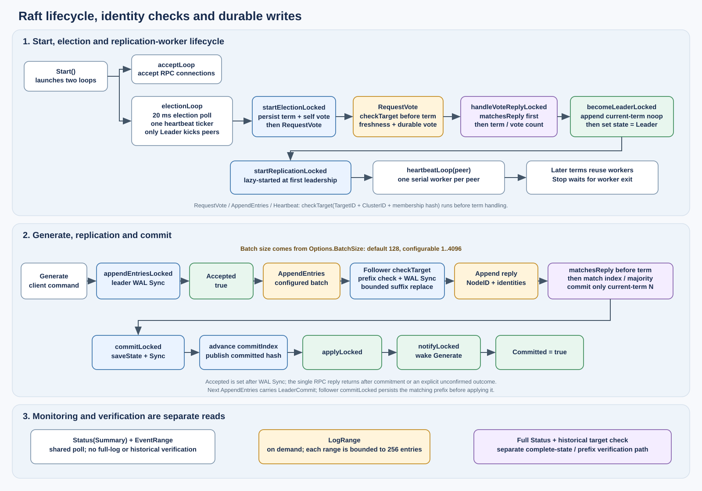
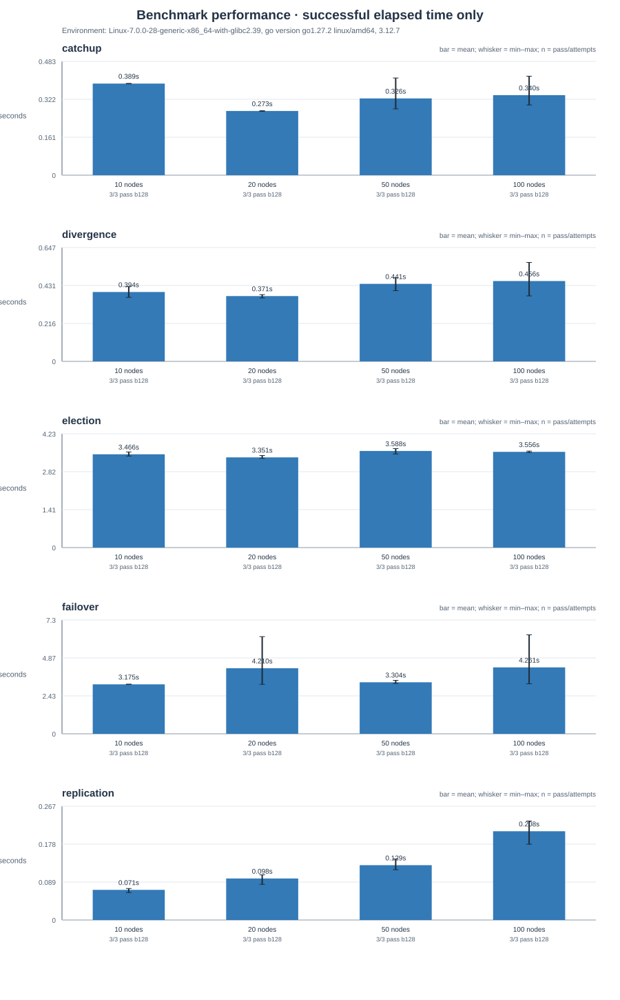

# 基于 Go 的固定成员 Raft 日志复制状态机

本轮验收基准源码为 `61ed114`（协议修复为 `5c64031`），逐文件摘要见本轮 environment.json。后续报告、打包入口和证据整理提交不冒充原测量版本。旧报告保留为 [report-cc7c185.md](report-cc7c185.md)。**人工可见终端关窗按使用者选择未执行；逐项 PASS / NOT RUN 见 [acceptance-a-g.md](acceptance-a-g.md)，本报告不宣称全部七项已通过。**

## 1. 目标与已有基础

项目在原 `myraft.zip` 的选举实现上扩展，保留固定成员 JSON 配置、Follower/Candidate/Leader 状态、随机选举、心跳、故障重选、term/votedFor 恢复、TCP net/rpc 和终端/文件双输出。新增日志匹配、批量复制、多数派提交、状态机执行、日志恢复、追赶与可复现实验。全部实现使用 Go/Python 标准库。

课程 a 项由配置驱动的 11 节点独立终端启动脚本覆盖；b 项由初选与随机宕机实验覆盖；c 项由 2101 条算术命令复制和日志摘要检查覆盖；d 项由预配置空节点追赶覆盖；e 项由合法未提交分歧夹具覆盖；f 项由统一运行事件输出覆盖；g 项由本报告及 SVG 调用图覆盖。实现与实际验证的边界分别说明，不把脚本具备功能等同于已经进行人工桌面验收。

## 2. 数据结构与角色转换

`Node` 保留原互斥锁、节点配置、任期、投票记录、角色、选举期限、连接集合和停止通道。新增日志切片、commitIndex、lastApplied、x，以及 Leader 专用 nextIndex/matchIndex。commitIndex 是已知提交的最高索引，lastApplied 是已执行的最高索引；nextIndex 是下一条待发送索引，matchIndex 是该 peer 已确认匹配的最高索引。角色和 x 不单独持久化，x 从已提交日志重建。索引 0 是内存哨兵；LogEntry 包含 Index、Term、Command，Command 使用 Op 和 int64 Value。

Follower 超时后增加任期、持久化对自己的投票并转为 Candidate。收到多数有效选票后，节点持久化一个本任期 noop，进入 Leader 并开始复制。更高任期的消息使节点持久化新任期并回到 Follower；同任期合法 Leader 的追加请求也会使 Candidate 跟随。单独更新任期不会延后选举期限；授予投票、收到非过期 Leader 的 AppendEntries（即使前缀不匹配）等协议事件才重置期限。一次任期最多投一名候选者。少数派可能不断竞选，失联旧 Leader 也可能暂留本地 Leader 角色，但两者都不能绕过多数派提交。

`Start` 启动 `acceptLoop` 与 `electionLoop`。每节点的 `electionLoop` 有一个选举轮询 ticker 和一个心跳 ticker；心跳 ticker 仅在节点为 Leader 时调用 `kickPeersLocked`，不是每个 peer 各自使用 ticker。首次执行 `becomeLeaderLocked` 时，先追加当前任期 noop，再切换为 Leader 并调用 `startReplicationLocked`；该函数按 peer 懒启动一个串行 `heartbeatLoop`，后续任期复用同一批 worker。`Stop` 关闭连接并等待这些 worker 退出后再关闭 WAL。另有在途投票调用上限，避免跨任期重复堆积。所有网络请求在锁外执行，发出前复制消息所需日志切片。状态和存储顺序由节点锁保护，磁盘 Sync 仍在锁内。

## 3. RPC 调用与关键算法



图为独立 SVG，可直接插入报告。`RequestVote`、`AppendEntries` 和兼容旧客户端的 `Heartbeat` 均先以 `TargetID`、`ClusterID`、成员摘要执行 `checkTarget`，再处理任期。投票回复和追加回复通过 `matchesReply` 核对预期成员 ID（wire 回复字段为 `NodeID`）、集群 ID 和成员摘要，之后才处理更高任期或计入投票/复制进度。地址只负责路由，不作为成员身份。

RequestVote 比较候选人的最后日志任期，再比较最后索引。日志过旧的候选者不能得到该节点选票。AppendEntries 检查 prevLogIndex/prevLogTerm，拒绝不匹配前缀并返回冲突位置。Leader 根据回复回退 nextIndex，再按配置批量发送日志。Follower 跳过已相同的条目，只替换首次冲突后的未提交后缀，不因空心跳或重复请求而删除额外尾部。

`Options.BatchSize` 控制 AppendEntries 每批上限，默认 128，允许配置范围为 1..4096。Leader 计算取得多数副本的索引 N，只在 log[N].Term 等于当前任期时直接提交；旧任期条目通过提交当前任期 noop 或命令间接提交。Follower 的提交上限为 min(LeaderCommit, PrevLogIndex + len(Entries))，不能把本地额外尾部当作已经与 Leader 匹配。已提交前缀不可覆盖，迟到回复只有在请求任期仍等于当前 Leader 任期时才能改变复制进度。

客户端 `Generate` 先将命令追加到 WAL 并 `Sync`，随后返回 `Accepted`；Leader 收到多数副本确认后，仅对当前任期索引推进提交。`commitLocked` 先同步保存 commitIndex 与摘要，再更新内存 commitIndex、应用状态机、通知等待者，Generate 醒来后才返回 `Committed`。写入超时或连接中断时，结果可能未知；没有请求去重 ID，因此不能自动重试可能已接受的命令。只有明确的未接受 not leader 回复允许重新发现 Leader。完整 `Status` 与历史目标索引校验由诊断/验收路径单独执行；监控 Summary 不包含完整日志或历史前缀校验。

### 真实入口调用关系

| 入口 | 主要调用链与返回条件 |
|---|---|
| CLI / Web 提交 | `SubmitGenerated → DiscoverLeader → Status(Summary) → Generate`；发现最多8路，遇到匹配身份的Leader提前结束；未知写入不重发 |
| RequestVote | `electionLoop → startElectionLocked → persistLocked → wire.Call → RequestVote → checkTarget → followHigherTermLocked / persistLocked`；回复经 `handleVoteReplyLocked（先 matchesReply）→ becomeLeaderLocked` |
| AppendEntries | `kickPeersLocked → heartbeatLoop → PeerClient.Call → AppendEntries → checkTarget → replaceLogLocked → WAL.Sync → commitLocked`；回复经 `handleAppendReplyLocked（先 matchesReply）→ advanceCommitLocked` |
| 提交与状态机 | `Generate → appendEntriesLocked` 设置 Accepted；`commitLocked → saveState → commitIndex/hash → applyLocked → notifyLocked` 后设置 Committed；RPC最终返回一次，不提前发送成功 |
| 恢复 | `NewNode → loadState → 身份核对 → loadLog → 校验已提交摘要 → trimWAL(仅合规短尾) → applyLocked`，完成后才 Start 与投票 |
| 观测与验证 | CLI 状态表/共享采集器调用 Summary；EventRange 补事件，LogRange按需复制≤256条；完整Status/TargetIndex仅显式验证时调用，浏览器不读WAL |

## 4. 状态机与持久化

x 初值为 0，按已提交日志顺序执行 add/sub/mul/div/mod；除数和模数不能为零。Go 整数除法向零截断，余数与被除数同号。固定种子生成的命令每隔 16 条先模 997，乘数最大 3，控制数值范围。每次 Generate 2101 产生恰好 2101 条算术命令；内部 noop 不计入算术命令数。

每节点保存一个元数据 JSON（term、votedFor、commitIndex、已提交前缀哈希）和一个命令 WAL。WAL v2 帧对长度/负载校验值构成的帧头以及 JSON 负载分别校验 CRC，记录一次逻辑后缀替换；普通追加无需重写全部历史日志。已提交前缀 SHA-256 只编码新增提交条目，保持原 JSON 编码和逐条换行；恢复时重建。元数据保存失败后不发布新提交索引或摘要，节点停止服务，不能再次使用已推进的累积状态。一致性摘要针对回放后的逻辑日志，不要求不同节点的 WAL 历史字节完全相同。写入顺序为日志 Sync → 更新内存日志；提交顺序为元数据保存并同步 → 更新 commitIndex 与提交摘要 → 顺序应用 → 通知等待者，Generate 随后确认 Committed。复制成功应答不会早于所需日志落盘。

恢复先完整回放 WAL，再检查最终 commitIndex 和已提交前缀哈希，从 x=0 仅重放已提交前缀。只有恢复验证通过才允许修剪短尾，避免损坏的后缀替换记录导致旧已提交内容复活。未提交尾部保留，但不执行。末尾不完整帧可以截回完整边界，完整帧校验错误或非法元数据会拒绝启动。没有日志压缩或快照；本实现验证进程崩溃恢复，不声称整机断电或磁盘永久损坏的耐久性。

独立算术参考由 `scripts/arithmetic_reference.py` 在实验节点停止后只读解析 WAL 与元数据，并用 Python 独立重算算术状态和摘要；它是实验验算，不是第二个 Raft，也不会修复实验文件。分歧 fixture 的 `fixture.json` 另记录每个节点启动前的 log index/term/hash、commit index/hash 与 x，作为逐节点初始 manifest。

## 5. 实验设计

实验环境依据输入记录填写：平台：Linux-7.0.0-28-generic-x86_64-with-glibc2.39；Go：go version go1.27.2 linux/amd64；Python：3.12.7；逻辑 CPU：128；节点 GOMAXPROCS：1。环境计时参数：election_min=3000 ms、election_jitter=3000 ms、heartbeat=150 ms、rpc_timeout=1000 ms。输入数据目录为 `public/myraft/validation/acceptance-20261020/benchmark`；节点为单机多进程并通过本机 TCP 通信，因此结果不能外推为真实多机或广域网性能。

计划参数：节点规模 10, 20, 50, 100；场景 election, failover, replication, catchup, divergence；每场景计划轮数 3；命令数、种子、超时分别为 entries：2101；seed：42；timeout：120。输入记录的测量口径：monotonic polling observation; per wait/generate timeout, not total scenario budget; two consistent snapshots 100 ms apart; includes polling overhead。缺少对应输入字段时显示“未记录”。

初次选举从首进程启动前计至两次一致的 Leader 观测，另记录初次外部观测 `initial_election_observed_seconds` 和 Leader 本地 `initial_local_election_ms`。本地计时从自投票持久化后进入 Candidate 开始，到当前任期 noop 落盘并成为 Leader 结束，不包含此前随机选举超时。故障恢复在提交输入所设命令数后，按种子终止 Leader 和部分 Follower，始终保留多数派；`election_observed_seconds` 计至新 Leader 被观察到，`service_restored_seconds` 计至新 Leader 成功提交一条新命令。原 `elapsed_seconds` 口径保留为故障开始至该写入提交。随后重启旧节点并验证追赶。空节点实验预留一个从未启动的配置成员，在其余节点提交输入所设命令数并停止写入后启动它，计至固定目标日志和状态一致；分歧场景另记录 `startup_to_sync_seconds`。

分歧夹具的共同已提交前缀为 129 个索引（term 1 noop 加 128 条算术命令）。A/B 两组分别保存 term 2/3 的不同长度未提交分支，各组均不足多数；中立节点保留共同前缀，可投票但不接收后续分支。`fixture.json` 保存每个节点各自的初始索引、末项任期、日志摘要、提交索引/摘要及 x，不以单一全局值代替节点初始状态。偶数节点时 term 2 还可从 B 中取得一张选票而不向该节点复制日志。这种历史不要求互相矛盾的已提交数据。启动后由正常 Raft 修复，并核对共同前缀的 hash/x 不变。未提交尾部可能合法丢弃，因此该场景的最终算术条目数不保证等于预置的最长分支。

分歧同步时间由新 Leader 的单调时钟 leader_age_ms 得到，终点是确认一致后的最后一次查询，因此为包含观测开销的上界；另保存启动到完成时间。故障重选和空节点场景额外在事件前保存固定 index/hash/x，并在新提交、旧节点恢复和空节点追赶后核对同一个历史前缀。全部场景同时比较完整日志哈希、已提交哈希、提交/应用索引、算术命令数和 x，不能仅凭最终 x 判定一致。

## 6. 实际结果

输入记录共 60 轮，实际节点数为 10、20、50、100 节点，实际场景为 空节点追赶、当选至分歧修复观测、初次选举（外部观测）、故障至新写入提交、命令提交（外部观测）；各组实际轮数为 3 轮。通过 60 轮，失败 0 轮，中断 0 轮；计划轮数为 60 轮，未执行 0 轮。节点/场景分组计数如下。统计表由输入 results.json 调用 benchmark.summarize 重算，仅以通过轮次计算时长统计。数据来源目录：`public/myraft/validation/acceptance-20261020/benchmark`。

| 节点数 | 场景 | 实际轮数 | 通过 | 失败 | 中断 | 未执行 |
|---:|---|---:|---:|---:|---:|---:|
| 10 | 空节点追赶 / batch 128 | 3 | 3 | 0 | 0 | 0 |
| 10 | 当选至分歧修复观测 / batch 128 | 3 | 3 | 0 | 0 | 0 |
| 10 | 初次选举（外部观测） / batch 128 | 3 | 3 | 0 | 0 | 0 |
| 10 | 故障至新写入提交 / batch 128 | 3 | 3 | 0 | 0 | 0 |
| 10 | 命令提交（外部观测） / batch 128 | 3 | 3 | 0 | 0 | 0 |
| 20 | 空节点追赶 / batch 128 | 3 | 3 | 0 | 0 | 0 |
| 20 | 当选至分歧修复观测 / batch 128 | 3 | 3 | 0 | 0 | 0 |
| 20 | 初次选举（外部观测） / batch 128 | 3 | 3 | 0 | 0 | 0 |
| 20 | 故障至新写入提交 / batch 128 | 3 | 3 | 0 | 0 | 0 |
| 20 | 命令提交（外部观测） / batch 128 | 3 | 3 | 0 | 0 | 0 |
| 50 | 空节点追赶 / batch 128 | 3 | 3 | 0 | 0 | 0 |
| 50 | 当选至分歧修复观测 / batch 128 | 3 | 3 | 0 | 0 | 0 |
| 50 | 初次选举（外部观测） / batch 128 | 3 | 3 | 0 | 0 | 0 |
| 50 | 故障至新写入提交 / batch 128 | 3 | 3 | 0 | 0 | 0 |
| 50 | 命令提交（外部观测） / batch 128 | 3 | 3 | 0 | 0 | 0 |
| 100 | 空节点追赶 / batch 128 | 3 | 3 | 0 | 0 | 0 |
| 100 | 当选至分歧修复观测 / batch 128 | 3 | 3 | 0 | 0 | 0 |
| 100 | 初次选举（外部观测） / batch 128 | 3 | 3 | 0 | 0 | 0 |
| 100 | 故障至新写入提交 / batch 128 | 3 | 3 | 0 | 0 | 0 |
| 100 | 命令提交（外部观测） / batch 128 | 3 | 3 | 0 | 0 | 0 |

| 节点数 | 场景 | 通过/尝试 | 均值/s | 中位数/s | 最小/s | 最大/s | 本地选举均值/ms |
|---:|---|---:|---:|---:|---:|---:|---:|
| 10 | 空节点追赶 / batch 128 | 3/3 | 0.389 | 0.389 | 0.388 | 0.390 | — |
| 10 | 当选至分歧修复观测 / batch 128 | 3/3 | 0.394 | 0.393 | 0.364 | 0.426 | — |
| 10 | 初次选举（外部观测） / batch 128 | 3/3 | 3.466 | 3.443 | 3.401 | 3.552 | 5.596 |
| 10 | 故障至新写入提交 / batch 128 | 3/3 | 3.175 | 3.169 | 3.169 | 3.186 | 7.035 |
| 10 | 命令提交（外部观测） / batch 128 | 3/3 | 0.071 | 0.074 | 0.064 | 0.074 | — |
| 20 | 空节点追赶 / batch 128 | 3/3 | 0.273 | 0.273 | 0.271 | 0.274 | — |
| 20 | 当选至分歧修复观测 / batch 128 | 3/3 | 0.371 | 0.374 | 0.360 | 0.379 | — |
| 20 | 初次选举（外部观测） / batch 128 | 3/3 | 3.351 | 3.318 | 3.315 | 3.420 | 8.214 |
| 20 | 故障至新写入提交 / batch 128 | 3/3 | 4.210 | 3.224 | 3.171 | 6.235 | 9.535 |
| 20 | 命令提交（外部观测） / batch 128 | 3/3 | 0.098 | 0.103 | 0.084 | 0.106 | — |
| 50 | 空节点追赶 / batch 128 | 3/3 | 0.326 | 0.284 | 0.281 | 0.413 | — |
| 50 | 当选至分歧修复观测 / batch 128 | 3/3 | 0.441 | 0.445 | 0.402 | 0.475 | — |
| 50 | 初次选举（外部观测） / batch 128 | 3/3 | 3.588 | 3.611 | 3.479 | 3.676 | 17.088 |
| 50 | 故障至新写入提交 / batch 128 | 3/3 | 3.304 | 3.249 | 3.232 | 3.431 | 24.259 |
| 50 | 命令提交（外部观测） / batch 128 | 3/3 | 0.129 | 0.125 | 0.118 | 0.143 | — |
| 100 | 空节点追赶 / batch 128 | 3/3 | 0.340 | 0.301 | 0.298 | 0.420 | — |
| 100 | 当选至分歧修复观测 / batch 128 | 3/3 | 0.456 | 0.435 | 0.372 | 0.562 | — |
| 100 | 初次选举（外部观测） / batch 128 | 3/3 | 3.556 | 3.551 | 3.531 | 3.585 | 38.629 |
| 100 | 故障至新写入提交 / batch 128 | 3/3 | 4.261 | 3.226 | 3.208 | 6.350 | 35.232 |
| 100 | 命令提交（外部观测） / batch 128 | 3/3 | 0.208 | 0.215 | 0.178 | 0.232 | — |

### 分项计时

以下指标分别按各组通过轮次计算；“未测得”表示该场景没有对应记录，不代表零耗时。

| 节点数 | 场景 | 指标 | 均值 | 中位数 | 最小 | 最大 |
|---:|---|---|---:|---:|---:|---:|
| 10 | 空节点追赶 / batch 128 | 初次选举外部观测（s） | 3.445 | 3.440 | 3.320 | 3.575 |
| 10 | 空节点追赶 / batch 128 | 初次本地 election_ms（ms） | 6.618 | 7.287 | 5.193 | 7.373 |
| 10 | 当选至分歧修复观测 / batch 128 | 初次选举外部观测（s） | 3.486 | 3.405 | 3.404 | 3.649 |
| 10 | 当选至分歧修复观测 / batch 128 | 初次本地 election_ms（ms） | 7.238 | 6.798 | 5.462 | 9.454 |
| 10 | 当选至分歧修复观测 / batch 128 | 启动至同步（s） | 3.638 | 3.558 | 3.555 | 3.801 |
| 10 | 初次选举（外部观测） / batch 128 | 外部选举观测（s） | 3.466 | 3.443 | 3.401 | 3.552 |
| 10 | 初次选举（外部观测） / batch 128 | 初次选举外部观测（s） | 3.466 | 3.443 | 3.401 | 3.552 |
| 10 | 初次选举（外部观测） / batch 128 | 初次本地 election_ms（ms） | 5.596 | 5.256 | 5.209 | 6.323 |
| 10 | 故障至新写入提交 / batch 128 | 外部选举观测（s） | 3.154 | 3.152 | 3.147 | 3.165 |
| 10 | 故障至新写入提交 / batch 128 | 初次选举外部观测（s） | 3.517 | 3.434 | 3.308 | 3.809 |
| 10 | 故障至新写入提交 / batch 128 | 初次本地 election_ms（ms） | 5.463 | 5.406 | 5.079 | 5.905 |
| 10 | 故障至新写入提交 / batch 128 | 故障后写入服务恢复（s） | 3.175 | 3.169 | 3.169 | 3.186 |
| 10 | 命令提交（外部观测） / batch 128 | 初次选举外部观测（s） | 3.779 | 3.816 | 3.579 | 3.941 |
| 10 | 命令提交（外部观测） / batch 128 | 初次本地 election_ms（ms） | 5.875 | 6.227 | 4.998 | 6.399 |
| 20 | 空节点追赶 / batch 128 | 初次选举外部观测（s） | 3.470 | 3.412 | 3.382 | 3.615 |
| 20 | 空节点追赶 / batch 128 | 初次本地 election_ms（ms） | 10.539 | 11.873 | 7.239 | 12.506 |
| 20 | 当选至分歧修复观测 / batch 128 | 初次选举外部观测（s） | 3.641 | 3.715 | 3.478 | 3.730 |
| 20 | 当选至分歧修复观测 / batch 128 | 初次本地 election_ms（ms） | 8.355 | 8.968 | 6.873 | 9.225 |
| 20 | 当选至分歧修复观测 / batch 128 | 启动至同步（s） | 3.794 | 3.867 | 3.628 | 3.887 |
| 20 | 初次选举（外部观测） / batch 128 | 外部选举观测（s） | 3.351 | 3.318 | 3.315 | 3.420 |
| 20 | 初次选举（外部观测） / batch 128 | 初次选举外部观测（s） | 3.351 | 3.318 | 3.315 | 3.420 |
| 20 | 初次选举（外部观测） / batch 128 | 初次本地 election_ms（ms） | 8.214 | 8.194 | 8.115 | 8.334 |
| 20 | 故障至新写入提交 / batch 128 | 外部选举观测（s） | 4.188 | 3.205 | 3.147 | 6.212 |
| 20 | 故障至新写入提交 / batch 128 | 初次选举外部观测（s） | 3.368 | 3.412 | 3.268 | 3.425 |
| 20 | 故障至新写入提交 / batch 128 | 初次本地 election_ms（ms） | 8.828 | 8.607 | 8.138 | 9.738 |
| 20 | 故障至新写入提交 / batch 128 | 故障后写入服务恢复（s） | 4.210 | 3.224 | 3.171 | 6.235 |
| 20 | 命令提交（外部观测） / batch 128 | 初次选举外部观测（s） | 3.517 | 3.507 | 3.394 | 3.651 |
| 20 | 命令提交（外部观测） / batch 128 | 初次本地 election_ms（ms） | 8.615 | 8.412 | 8.171 | 9.262 |
| 50 | 空节点追赶 / batch 128 | 初次选举外部观测（s） | 3.439 | 3.436 | 3.428 | 3.454 |
| 50 | 空节点追赶 / batch 128 | 初次本地 election_ms（ms） | 11.662 | 11.297 | 10.315 | 13.374 |
| 50 | 当选至分歧修复观测 / batch 128 | 初次选举外部观测（s） | 3.503 | 3.488 | 3.387 | 3.635 |
| 50 | 当选至分歧修复观测 / batch 128 | 初次本地 election_ms（ms） | 12.667 | 12.501 | 9.962 | 15.537 |
| 50 | 当选至分歧修复观测 / batch 128 | 启动至同步（s） | 3.667 | 3.649 | 3.550 | 3.801 |
| 50 | 初次选举（外部观测） / batch 128 | 外部选举观测（s） | 3.588 | 3.611 | 3.479 | 3.676 |
| 50 | 初次选举（外部观测） / batch 128 | 初次选举外部观测（s） | 3.588 | 3.611 | 3.479 | 3.676 |
| 50 | 初次选举（外部观测） / batch 128 | 初次本地 election_ms（ms） | 17.088 | 15.848 | 14.241 | 21.174 |
| 50 | 故障至新写入提交 / batch 128 | 外部选举观测（s） | 3.281 | 3.228 | 3.207 | 3.408 |
| 50 | 故障至新写入提交 / batch 128 | 初次选举外部观测（s） | 3.482 | 3.467 | 3.433 | 3.546 |
| 50 | 故障至新写入提交 / batch 128 | 初次本地 election_ms（ms） | 17.206 | 19.655 | 11.905 | 20.058 |
| 50 | 故障至新写入提交 / batch 128 | 故障后写入服务恢复（s） | 3.304 | 3.249 | 3.232 | 3.431 |
| 50 | 命令提交（外部观测） / batch 128 | 初次选举外部观测（s） | 3.445 | 3.467 | 3.396 | 3.472 |
| 50 | 命令提交（外部观测） / batch 128 | 初次本地 election_ms（ms） | 13.438 | 13.250 | 12.109 | 14.954 |
| 100 | 空节点追赶 / batch 128 | 初次选举外部观测（s） | 3.526 | 3.520 | 3.512 | 3.546 |
| 100 | 空节点追赶 / batch 128 | 初次本地 election_ms（ms） | 43.381 | 35.031 | 34.796 | 60.315 |
| 100 | 当选至分歧修复观测 / batch 128 | 初次选举外部观测（s） | 3.592 | 3.614 | 3.474 | 3.687 |
| 100 | 当选至分歧修复观测 / batch 128 | 初次本地 election_ms（ms） | 23.847 | 19.629 | 15.018 | 36.895 |
| 100 | 当选至分歧修复观测 / batch 128 | 启动至同步（s） | 3.764 | 3.782 | 3.651 | 3.859 |
| 100 | 初次选举（外部观测） / batch 128 | 外部选举观测（s） | 3.556 | 3.551 | 3.531 | 3.585 |
| 100 | 初次选举（外部观测） / batch 128 | 初次选举外部观测（s） | 3.556 | 3.551 | 3.531 | 3.585 |
| 100 | 初次选举（外部观测） / batch 128 | 初次本地 election_ms（ms） | 38.629 | 37.170 | 21.073 | 57.644 |
| 100 | 故障至新写入提交 / batch 128 | 外部选举观测（s） | 4.232 | 3.199 | 3.177 | 6.320 |
| 100 | 故障至新写入提交 / batch 128 | 初次选举外部观测（s） | 3.530 | 3.561 | 3.446 | 3.585 |
| 100 | 故障至新写入提交 / batch 128 | 初次本地 election_ms（ms） | 36.415 | 34.696 | 34.481 | 40.069 |
| 100 | 故障至新写入提交 / batch 128 | 故障后写入服务恢复（s） | 4.261 | 3.226 | 3.208 | 6.350 |
| 100 | 命令提交（外部观测） / batch 128 | 初次选举外部观测（s） | 3.474 | 3.482 | 3.457 | 3.483 |
| 100 | 命令提交（外部观测） / batch 128 | 初次本地 election_ms（ms） | 37.509 | 43.571 | 18.815 | 50.140 |

观测耗时包含进程启动、磁盘同步、调度与查询成本，不能把曲线变化全部归因于 Raft 网络通信。本地 election_ms、外部选举观测、故障后写入服务恢复和启动至同步分别使用不同起止点，按分项计时表分别报告；本报告只描述上述输入记录，不据此给出生产系统尾延迟保证。监控轮询中的 Summary 与 EventRange 共享采样周期；LogRange 仅在需要查看日志时按范围读取，单次最多返回 256 项。Summary、完整 Status 与历史目标索引校验是不同观测路径，不把监控摘要当作完整一致性验收。

## 7. 测试与优化过程

验证清单取自输入文件 `public/myraft/validation/acceptance-20261020/checks.json`；缺少清单字段时显示“未记录”。

| 检查 | 实际结果 |
|---|---|
| Linux go fmt / vet / build | PASS |
| Linux go test -count=1 | 77 top-level tests PASS; 42 subcases PASS |
| Linux go test -race -count=1 | 77 top-level tests PASS; 42 subcases PASS |
| Python unittest | 34 PASS |
| Linux 3/11 node smoke | 2/2 PASS |
| Windows Go vet/test/build | PASS (Go 1.26.3) |
| Windows Python unittest | 32 PASS; 1 Linux-only SKIP |
| Windows 3/11 smoke | 2/2 PASS |
| Windows prebuilt startup/demo | PASS after test-fixture path repair |
| Linux 10/20/50/100 five scenarios three rounds | 60/60 PASS; 60/60 independent WAL references |
| Linux 11 node 2101 four-scenario pilot | 4/4 PASS; independent reference |
| Real Chromium six-page operations | PASS after cancel-test contract correction |
| Real Chromium 100-node grid | PASS (100 reachable, 100 rendered) |
| Synthetic UI regression | 8 PASS; 1 live-check SKIP |
| Windows native HTTP console 11-node recovery/history/export | PASS |
| Manual visible terminal closing | NOT RUN - explicitly deferred by user |
| Windows race | NOT RUN - C compiler not configured |
| Fresh portable ZIP | NOT RUN - pending this round |

## 历史开发记录（不属于本轮输入结论）

以下内容是历史故障与修复记录，不构成本轮实验环境、结果或验证结论。开发中曾记录初版失败与中断：每 peer 定时器造成非 Leader 的多余唤醒，短连接心跳产生较多 TIME_WAIT；旧环境诊断曾观测约 24698 个 TIME_WAIT 连接、约 71% CPU 负载。原始日志还记录了 `runtime: createevent failed; errno=1450` 和 `fatal error: runtime.semacreate`，表明旧 Windows 运行中出现过系统资源分配失败。这些证据不能单独定位到临时端口、内核事件或其他具体资源。后续版本统一每节点心跳定时器、复用每个复制任务的 TCP 连接，并在成功调用后清除 deadline，避免 net/rpc 后台 reader 空闲超时；还调整过服务时限和进程调度参数，并给每 peer 的投票调用加上在途上限。多项改变同时发生，不能把旧版与后续性能差异单独归因于某一项优化。

历史复核还修复过 WAL 长度字段损坏误判短尾以及停止失败时丢失进程句柄的问题，并加入已提交后缀替换记录损坏/缺失和真实 RPC 超时重连的测试。未完成或被中断的旧轮次不计为通过。以上历史信息与本轮结果输入分开记录。

## 8. 复现与局限

按项目 README 安装所需工具并运行格式检查、静态检查、单元测试、构建、集成与 Python 回归。演示使用项目提供的启动脚本，并按 README 给出的配置和数据目录运行节点及状态机命令。本轮参数对应的复现命令：

```
python scripts/benchmark.py --nodes 10 20 50 100 --scenarios election failover replication catchup divergence --rounds 3 --batch-sizes 128 --entries 2101 --seed 42 --timeout 120
```

使用原配置/ID/数据目录重启关闭节点，不删除投票记录。重新运行时应使用目标环境的输入参数和环境记录；本轮数值不能替代其他环境的测量。

当前没有动态成员、快照压缩、客户端 exactly-once、业务线性一致读、真实多进程分区注入框架或生产安全机制；旧 Leader 在失去多数时可能保留本地角色，但不能提交。WAL 持续增长，文件系统 Sync 成本仍影响大规模性能。

## 参考

Diego Ongaro and John Ousterhout. *In Search of an Understandable Consensus Algorithm (Extended Version)*，Figure 2 与第 5 节：https://raft.github.io/raft.pdf 。实现以原项目和课程 a–g 要求为基础，报告中的实验结论仅对应记录的实测版本；公开的脱敏结果与源码对应关系见 `validation/README.md`。

## 本轮结果讨论及课堂边界



每柱标注三次成功/尝试次数，误差线为实测最小至最大值，原始逐轮结果、停止节点名单、初始分歧清单和独立算术核查均可追溯。初选外部观测含3–6秒随机超时和启动/轮询，而本地选举仅从Candidate开始；因此两者差异不能解释为网络延迟。少数故障恢复轮次经历更长等待，按实际记录计入均值，不删掉较慢结果。分歧、追赶等小于一秒的观测受100毫秒轮询和本机磁盘缓存影响；不报告可靠 p99，也不外推跨机器性能。

与原项目相比，固定成员身份现在同时约束磁盘恢复、请求接收和回复计票。已复现并修复的错误路由可将一个真实节点算成两个成员，这是运行保护缺口；不把它描述成标准Raft在正确成员路由下的反例。默认端口配置的正常写入未观察到该问题。新真实TCP回归分别证明误路由不能形成虚假选举多数，也不能形成虚假复制多数。

普通事件采用有界单消费者队列；拥塞时Status计数，并在输出恢复后打印output_dropped。永久阻塞外部Writer仍可能留下一个消费者直到进程退出。WAL与内存日志持续增长（没有快照）；当过Leader的节点保留其worker，长期领导轮换的worker上限仍是N×(N−1)。Sync仍在节点锁内，以维持简单持久化顺序。课堂实验范围内不再引入复杂缓存或取消持久化。

真实Chromium六页操作包括双击提交去重到一次发送、停止确认取消、Leader恢复、同一历史检查点、独立实验取消与ZIP；1/5/10浏览器各5轮均为55次共享监控RPC。0/10浏览器各6次256命令测量仅用作负载观察，不能凭少量样本断言无性能代价。合成UI用例仅验证交互/大整数显示，不计作Raft协议实验。

## Win11 原生补充实验与失败说明

工具链为 Go 1.26.3、Python 3.13.12，Win11 专业版 build 26200，8 vCPU、8 GiB RAM。第一次原生四规模选举/分歧各三轮共24轮，23通过、1失败。100节点分歧第1轮的状态查询CLI在进入main之前报 `out of memory allocating heap arena map`，该轮不计入成功均值，也不将其归为已发生的Raft日志丢失。源记录在 `validation/acceptance-20261020/windows-scale`。

当时系统提交上限约9.35 GB，C盘仅约90 MiB空闲、页面文件768 MiB。另一次100节点诊断运行采样到约8.11 GB提交量，但没有覆盖原失败瞬间，不能证明唯一根因。保留原设置后，在项目虚拟机P盘新增4 GiB固定页面文件，C盘仍保留系统管理的页面文件；重启后的提交上限约13.29 GB。该改动仅作用于测试VM，不由交付程序修改老师的系统。Windows页面文件增长可能导致分配失败的机制与操作依据见[微软说明](https://learn.microsoft.com/en-us/troubleshoot/windows-client/performance/slow-page-file-growth-memory-allocation-errors)。

新环境中100节点选举和分歧各三轮全部通过，且独立WAL核查通过，单独保存在 `windows-capacity-retest`。这只是容量调整后本次重测的事实，不是排除所有资源故障或唯一根因的证明。分歧同步的一次14.626575秒结果保留在均值和范围中；不与Linux或原页面文件环境合并比较，不包装为稳定优化收益。

| Windows环境 | 节点 | 场景 | PASS/尝试 | 均值/s | 中位/s | 最小/s | 最大/s |
|---|---:|---|---:|---:|---:|---:|---:|
| 初始页面文件 | 10 | divergence | 3/3 | 0.866 | 0.859 | 0.858 | 0.881 |
| 初始页面文件 | 10 | election | 3/3 | 4.864 | 4.794 | 4.477 | 5.322 |
| 初始页面文件 | 20 | divergence | 3/3 | 0.934 | 0.936 | 0.919 | 0.947 |
| 初始页面文件 | 20 | election | 3/3 | 4.095 | 4.140 | 3.885 | 4.261 |
| 初始页面文件 | 50 | divergence | 3/3 | 1.343 | 1.232 | 1.178 | 1.618 |
| 初始页面文件 | 50 | election | 3/3 | 4.395 | 4.371 | 4.290 | 4.524 |
| 初始页面文件 | 100 | divergence | 2/3 | 1.381 | 1.381 | 1.312 | 1.451 |
| 初始页面文件 | 100 | election | 3/3 | 4.884 | 4.862 | 4.835 | 4.956 |
| P盘新增4GiB | 100 | divergence | 3/3 | 5.827 | 1.454 | 1.400 | 14.627 |
| P盘新增4GiB | 100 | election | 3/3 | 5.102 | 4.744 | 4.648 | 5.914 |
