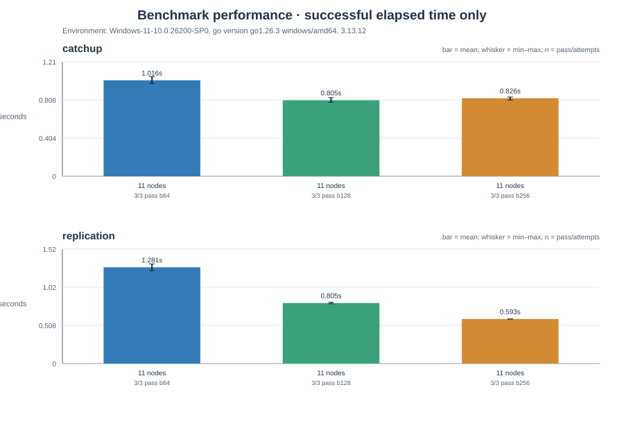
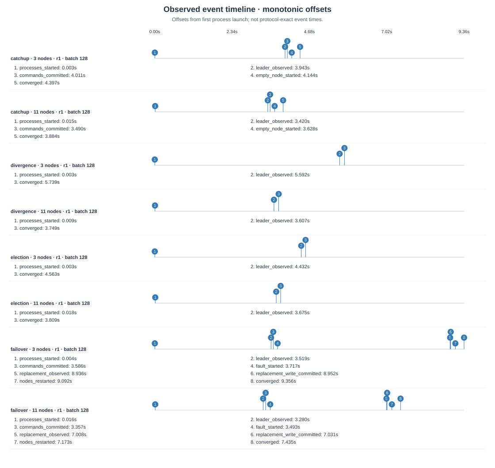

# 终端演示与后端测量

本轮实现保持 Go 标准库、net/rpc、固定成员和 WAL v2。没有改变已提交前缀保护、当前任期多数派提交、落盘后应答和不确定写入不自动重试的条件。本地起点为 fd7e8d0，未自动推送远端。

## 使用方式

在配置好 Go/Python 的 Windows 终端进入仓库：

```powershell
powershell -NoProfile -ExecutionPolicy Bypass -File scripts/start.ps1 -RunDir demo-runs/classroom
.\demo.bat demo-runs/classroom
```

启动依次报告进程启动、Status 可达、观察到一致 Leader；不会自动写入算术命令。菜单提供状态、刷新、生成 2101 条命令、验证、停止指定节点、恢复节点和停止本会话全部节点。只有收到明确提交确认才显示 COMMITTED；关闭菜单保留节点，结束演示需选择停止全部。恢复节点后使用 verify 检查追赶。

直接观察：

```powershell
.\raft-node.exe -config demo-runs/classroom/nodes.json -status-all -format table -watch 1s
```

表格展示真实节点状态，错误节点显示错误及占位符；本地 Leader 角色不等于当前仍拥有多数派。默认 JSON 与完整一致性验证保持原有语义。watch 串行查询并有界等待，Ctrl+C 停止；JSON watch 输出一行一个数组，便于日志收集。

`scripts/session.ps1` 记录并核对 PID、启动时间、程序路径/摘要、固定配置与命令参数，不按进程名批量终止。停止模拟进程故障并保留数据。程序或配置发生变化时拒绝控制，因此应先停止演示再重新构建。会话文件只用于本机进程管理，不是安全认证机制，也不应随项目公开。

## 后端测量与取舍

对 21010 条日志、存在未提交尾部的 Status 查询，原完整查询中位数约 34.515 ms，分配约 1.93 MiB；轻量监控约 95.4 ns、零分配。CPU profile 指向 JSON 编码/哈希，mutex profile 确认完整查询会占用节点锁。

两种查询语义不同：轻量模式只复制已维护的索引、计数、x 和角色，不计算完整日志或历史前缀，不能代替 verify。完整查询的校验没有被省略，也没有给未提交日志增加缓存；已经全部提交的原 Status 路径本来就很轻。上述数字是函数级微基准，不代表 RPC 延迟或集群吞吐。

复制批次可用 `-batch-size` 设置，默认仍为 128。Win11 中用同一构建比较三个批次；提交/追赶分别三轮，全部通过。下表前两列是 Win11 11 节点的均值；后两列是另一个 Linux 三节点真实 TCP 微基准的分配中位数，统计范围不同，不能混作同一环境的测量。

| 每批条数 | Win11 提交/s | Win11 追赶/s | Linux 三节点分配/MiB | Linux 分配次数 |
|---:|---:|---:|---:|---:|
| 64 | 1.281 | 1.016 | 3.30 | 21712 |
| 128 | 0.805 | 0.805 | 4.12 | 19669 |
| 256 | 0.593 | 0.826 | 3.97 | 18286 |

256 在本次提交测量中更快，128 的追赶均值略低。保持默认 128，允许课堂实验显式选择其他批次；本次只有 11 节点虚拟机和少量重复，不能推出统一测试机或更大规模下的最优值。每批所需的持久化仍先于成功应答，批次大小变化不会让未提交内容提前执行。



## 图表与故障时间线

```powershell
python scripts/benchmark.py --nodes 11 --entries 2101 --rounds 3 --batch-sizes 64 128 256 --scenarios replication catchup --output .test-output/batch-comparison
python scripts/visualize.py --input .test-output/batch-comparison --output figures/batch-comparison
```

图表生成器仅使用 Python 标准库，输出独立 SVG 与索引。柱形统计按节点/场景/批次分开，保留成功/尝试数，失败不按零秒处理。新 replication 场景测量从发起 Generate 到确认提交，另记全部节点应用完成的观测耗时。

时间线以首进程启动前为原点，直接记录进程启动、观察到 Leader、命令提交、故障开始、新 Leader/新写入、节点重启和收敛等实际观测。缺少 events.json 的旧记录不会被补造时间线。下图来自本轮 Linux 四场景，包含 Leader 故障和恢复：



## 验证与限制

Go 格式、vet、构建、单元测试、Linux race、17 项 Python 回归、3/11 节点 smoke、原四场景 8 轮均通过。Win11 的 18 轮批次实验通过；菜单的 2101 命令、故障后写入、原目录恢复、历史前缀、身份不匹配拒绝、其他目录进程保护、中文加空格路径以及菜单入口已自动验收。

首次 Windows 验收暴露了测试脚本输出重定向等待和命令行末尾空格匹配问题；更换为有界流读取、修正参数匹配后重测通过。另实测了默认 ANSI 读取 UTF-8 会话路径的问题，显式 UTF-8 读取后中文路径测试通过。失败记录保留在本地，未计入通过轮次。

未进行 Windows race 或人工登录桌面的完整键盘操作；SYSTEM 会话的自动动作不等于人工桌面验收。没有新增生产级认证、动态成员、快照或请求去重。测量来源、摘要与未执行项见 [本轮证据](../validation/ux-20261019/README.md)，旧实验目录保持不变。
