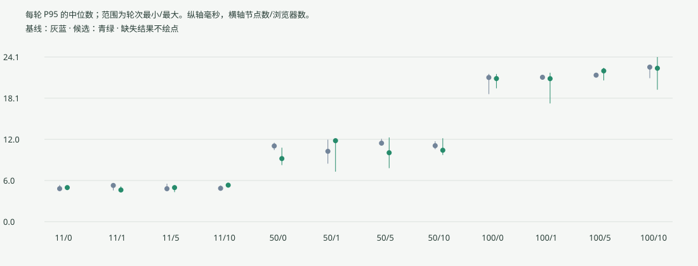
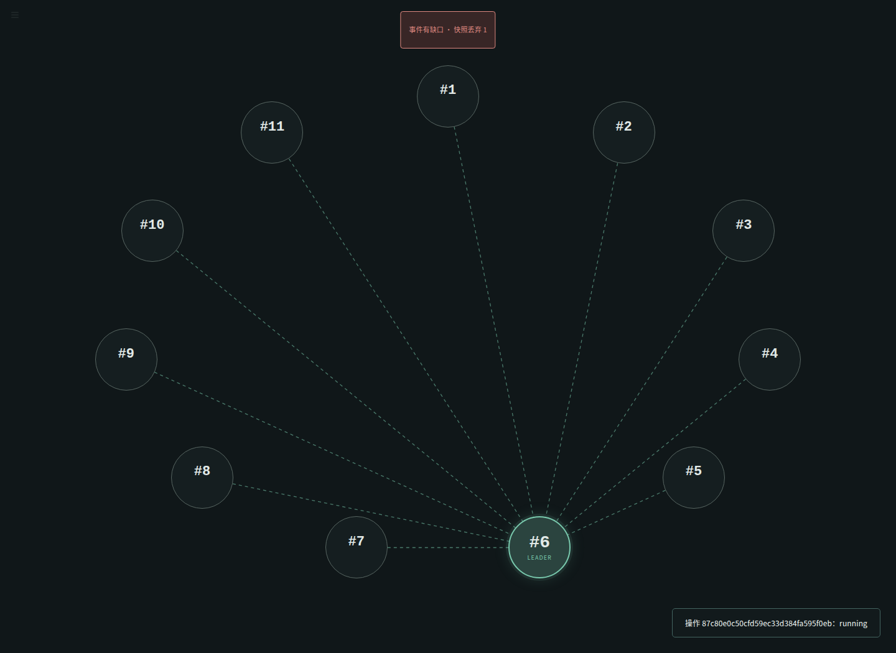
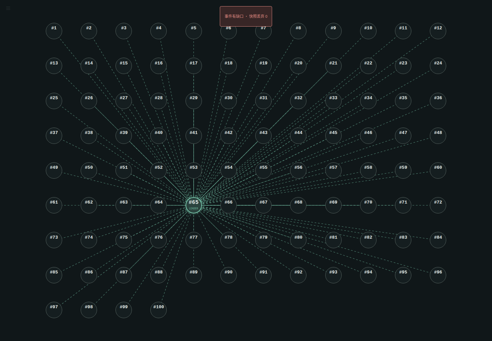

# 新阶段证据：性能与沉浸式控制台

矩阵测量版为 `88bd633`，最终实现为 `ef130d9`。最终仅撤除实验进度的重复复制，并修复打包字节复用；Raft、界面和只读采集路径相同。最终测试与六页操作单列。原正式 ZIP 与 `validation/acceptance-20261020` 保持不变。此目录所有结果均来自实际运行；`ui-acceptance` 的合成测试单独标注，不充当协议或 Windows 桌面证据。

## 来源与比较

|目录|用途与实际结果|
|---|---|
|`baseline-latency-v2`|原 `2de62ea`，11/50/100 × 0/1/5/10 浏览器 × 3 轮；36/36|
|`candidate-latency-v2`|开发候选，36/36；此后仍有界面细节变化，不视为最终全部生产文件认证|
|`final-latency`、`final-latency-50`|冻结版的 11/100 与 50 节点测量，24/24 和 12/12；每组 200 正式请求，另 20 预热|
|`final-latency-all`|上述两个最终数据集的汇总，合并前核对源码和三个二进制摘要完全一致；不是另跑的一组实验|
|`final-comparison`|基线与最终冻结版同环境比较，JSON/CSV/Markdown/SVG 可复算|
|`baseline-collector-off`、`candidate-collector-off`|关闭采集器的额外测量，各 6/6；不与“0 浏览器但采集器开启”混同|
|`reverse-recheck`、`reverse-recheck-50`|初测退化组合的 BA/AB/BA 顺序复测，18/18 和 6/6；均保留原始样本|
|`windows-evidence`|Windows 两版本的 11/100 节点各 6/6；原包 EXE 写入后新 EXE 原盘恢复的独立核查|
|`windows-recheck-data`|Windows 11 节点交替顺序再测，6/6|
|`windows-comparison`、`windows-recheck-comparison`|Windows 结果单列；禁止与 Linux 合算加速比|

[Linux 最终比较](final-comparison/comparison.md) · [Linux 交替复测](recheck-comparison/comparison.md) · [50 节点补充复测](recheck-50-comparison/comparison.md) · [Windows 初测](windows-comparison/comparison.md) · [Windows 复测](windows-recheck-comparison/comparison.md)

P95 是成功请求的经验分位数，比较表是每轮分位数的中位数与范围。波动和反向变化保留；局部编码/锁占用改善不等于整机普遍提速。交替复测没有在全部配对轮次稳定重现超过 5% 的退化，也不足以证明所有环境没有退化。

## 正确性与规模

`final-course-regression`：10/20/50/100 节点，选举、故障至新提交、空节点追赶、合法分歧恢复、2101 命令复制五场景各三轮，60/60。各轮保存配置、状态、历史检查点/初始分歧清单以及独立 WAL 算术核查。

`baseline-batches` 与 `final-batches-11`：11 节点 64/128/256/512 批次、复制/追赶/分歧各三轮，各 36/36。`baseline-large-batches`：50/100 节点 128/512，各 36/36；最终 128 对应 `final-course-regression`，最终 512 对应 `final-large-512` 的 18/18。计时包含外部轮询，不能把 100ms 量级差值解释成纯网络耗时。默认批次仍是 128。

`final-go-tests.jsonl` 与 `final-race-tests.jsonl`：各 83 顶层测试、46 子用例 PASS；长测在常规套件中显式跳过并单独运行。`final-python.txt`：43 项 PASS。`final-smoke.txt`：3/11 节点通过。Windows 原生 Go、Python、启动、恢复记录单列；初次辅助脚本漏掉 PowerShell PATH 的失败保留，修正的是测试环境。

最终 `release-go-tests.jsonl`、`release-race-tests.jsonl`、`delivery-go-tests.jsonl` 对应撤除重复复制后的实现；原 83 项中撤除一项不必要的输入不变性测试，最终为 82 顶层、46 子用例。Python 增加打包读取字节复用测试，最终 44 项。`experiment-snapshot-red/green.txt` 仅为输入别名探针：原 SSE 发布前已深拷贝，不证明生产路径存在竞态。

## 资源与性能分析

`baseline-soak-*`、`candidate-soak-*`：两版本分别完成 11 节点 30 次停止恢复，以及 100 节点在 30 分钟内完成 20 次停止恢复。100 节点后半段不增加日志；已记录的 goroutine、连接与存活堆没有持续上升，Stop 后返回测试前 goroutine 数量。此为单进程真实 TCP，不能冒充 100 个进程的 RSS。

`resource-summary.json` 与各延迟用例的 `resources.json` 记录节点加控制器的进程资源。浏览器/probe 不在该资源求和中；Windows 为 working set，RSS 求和可重复计算共享页。微基准、profile 摘要分别在根目录及 `profiles`，原始二进制 profile 因包含本机调试路径保留在隔离实验目录，SHA 已登记。

## 界面与实操

`real-console-release`：冻结版真实 Chromium 六页流程，11 节点 2101 命令、停止确认/取消、重选、恢复、历史核查、独立实验/取消、导出摘要、主题和投影操作。1/5/10 浏览器各观察五轮，监控 RPC 都为 55。

`real-100`：100 个真实节点提交 2101 命令后，保存完整验证、实际 Summary、独立算术核查及桌面/手机截图。截图来自 Linux Chromium，不是 Windows 桌面。

`ui-acceptance`：9 项合成测试通过，1 个 live URL 用例跳过；合成节点只用于布局、事件去重、后台恢复、输入与精度测试。100 节点更新成本保存在 `synthetic-render-cost.json`。开发期失败保留在 `development-failures`，不充当最终结果。

`real-console-4173d24`：撤除重复复制后再次执行六页真实操作；操作路径、截图和回执对应最终生产代码。

## 文件处理与未执行项

`provenance.json` 对复制的证据记录原始与交付 SHA。交付时缩写本机绝对路径、移除 JSON 中进程 ID；数字结果、源码/二进制摘要不变。比较文件中的输入 SHA 指向原始文件，可通过该清单追溯；在脱敏文件上重新生成比较，输入摘要会改变，数值应相同。原始 WAL、完整输出和二进制 profile 保留在独立实验目录，未打入绿色包。

`portable-candidate`：实际新目录 Win11 自动验收，包含两个根入口、11 节点 2101 条命令、原盘/全体恢复、同一历史前缀、Web 当前/历史验证及导出。隔离 Go/Python PATH 后普通演示通过，依赖缺失字段正确显示；自有进程清理为零。SYSTEM 自动操作不证明已登录桌面的可见窗口。

新 ZIP 的精确归档操作结果见包旁 `.acceptance.json`；尚未运行时不能用本目录替代它。新版本登录桌面可见终端/真人关窗、Windows race、老师统一电脑仍分别记录 NOT RUN。原用户提供的 r2 桌面记录不自动升级新版本状态。
